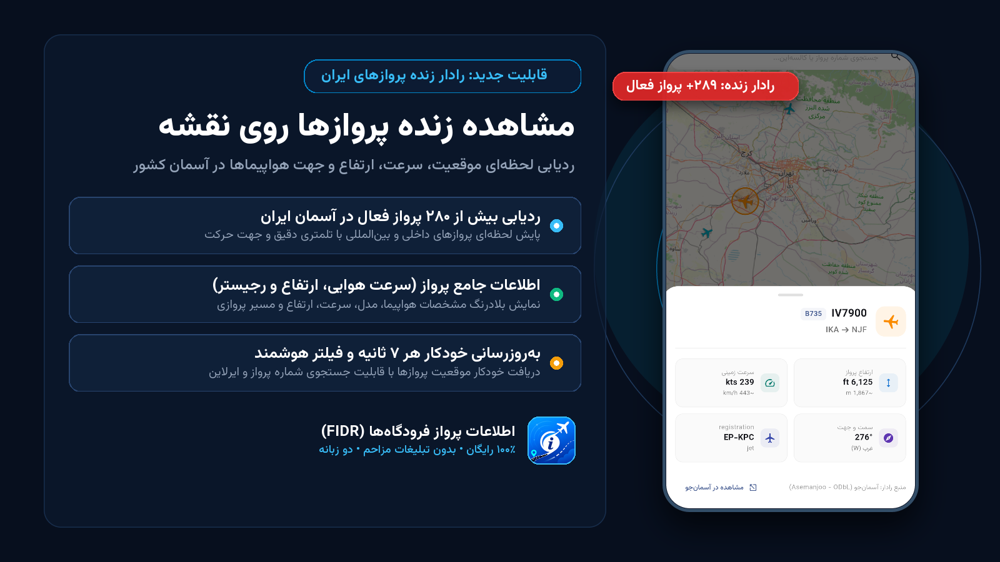
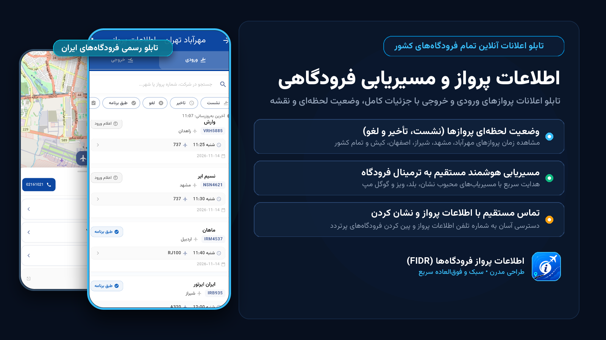
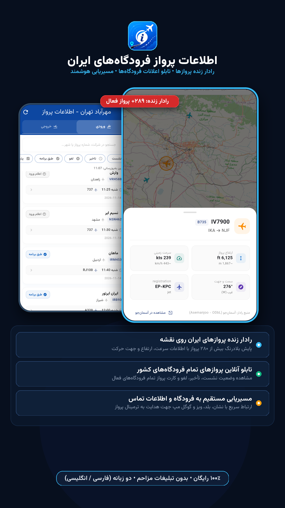
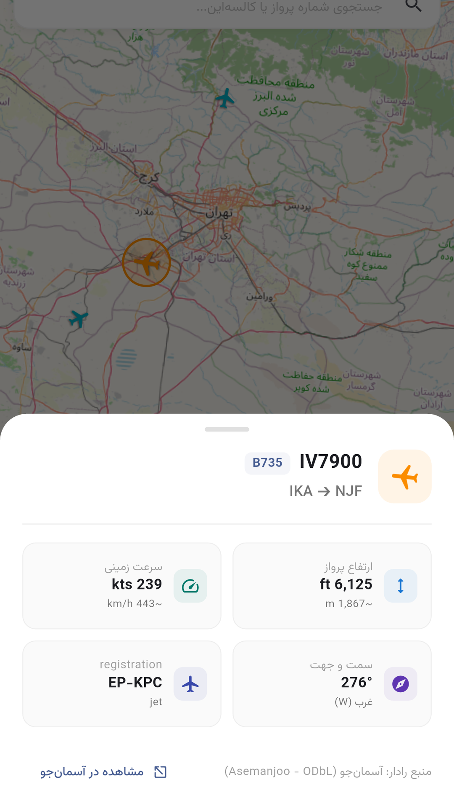
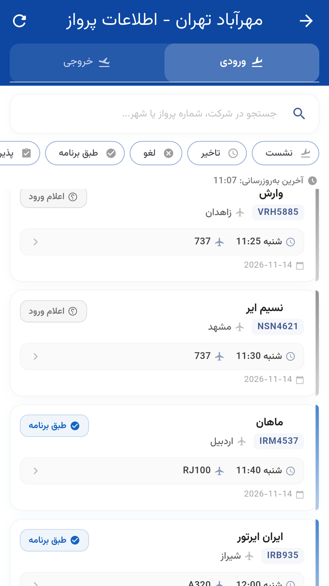
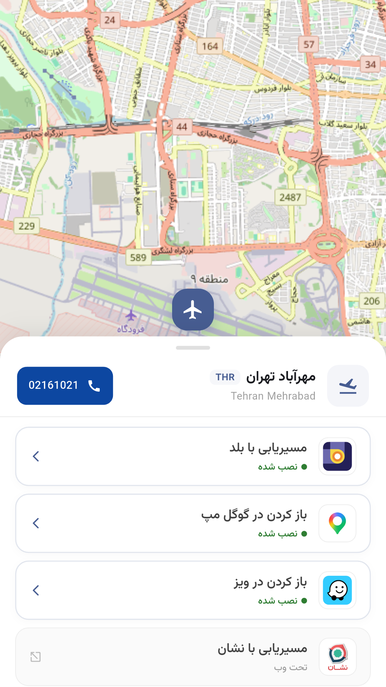
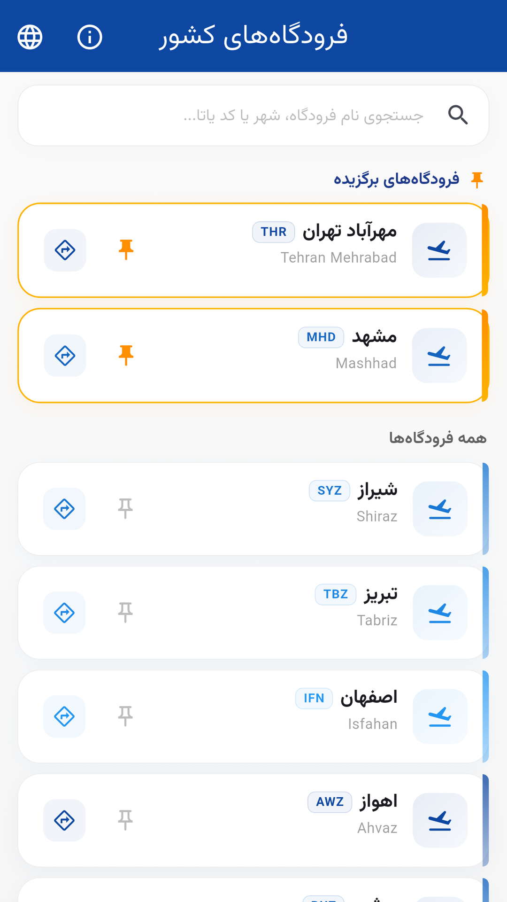

<p align="center">
  
</p>

<h1 align="center">✈️ اطلاعات پرواز و رادار زنده فرودگاه‌های ایران</h1>
<h3 align="center">Iran Airports Flight Information Display (FIDS) & Live Radar</h3>

<p align="center">
  <strong>جامع‌ترین اپلیکیشن اطلاعات پرواز، رادار زنده آسمان ایران و مسیریابی هوشمند فرودگاهی</strong>
  <br>
  Real-time flight board data from <a href="https://fids.airport.ir">fids.airport.ir</a> & Live ADS-B radar from <a href="https://asemanjoo.ir">Asemanjoo</a>
</p>

<p align="center">
  <a href="https://github.com/hosseinMsh/IranNationalAirportFIDR/releases"></a>
  
  
  
  
</p>

---

## 🎨 پوسترهای رسمی اپلیکیشن (Official Promotional Posters)

<p align="center">
  
</p>

<p align="center">
  
</p>

<p align="center">
  
</p>

---

## ✨ قابلیت‌های برجسته (Key Features)

### 🛰️ ۱. رادار زنده پروازهای ایران (Live Flight Radar)
- **پایش لحظه‌ای بیش از ۲۸۰ پرواز فعال:** مشاهده زنده موقعیت تمام هواپیماهای در حال پرواز بر فراز آسمان ایران روی نقشه تعاملی.
- **اطلاعات تلمتری دقیق (ADS-B):** نمایش سرعت زمینی (Knots & km/h)، ارتفاع پرواز (Feet & Meters)، زاویه و جهت حرکت (Heading)، مدل هواپیما، کد رجیستر، ایرلاین، مبدأ و مقصد.
- **تفکیک رنگی ارتفاع پرواز:** تشخیص سریع ارتفاع هواپیما با کد رنگی نئونی (صعود، کروز، نزول و لندینگ).
- **به‌روزرسانی خودکار هر ۷ ثانیه:** دریافت پیوسته و هوشمند ترافیک هوایی کشور بدون نیاز به رفرش دستی.
- **جستجوی پیشرفته و فیلتر:** جستجوی آنی بر اساس شماره پرواز، کالسایت (Callsign) و شرکت‌های هواپیمایی.

### 📋 ۲. تابلو آنلاین اعلانات پروازها (FIDS Flight Boards)
- **پوشش بیش از ۳۰ فرودگاه فعال کشور:** مهرآباد، مشهد، شیراز، اصفهان، تبریز، کیش، اهواز، بندرعباس و تمام فرودگاه‌های بین‌المللی و داخلی.
- **پروازهای ورودی و خروجی:** دسترسی تفکیک‌شده به زمان‌بندی دقیق ورود و خروج هر فرودگاه.
- **وضعیت دقیق پروازها:** نشست، تأخیر، لغو، بر اساس برنامه، اعلام ورود، شروع سوار شدن، پرواز کرد و شماره ترمینال.
- **نشان‌کردن فرودگاه‌های پرتردد:** پین کردن فرودگاه‌های محبوب برای دسترسی سریع در بالای لیست.

### 🧭 ۳. نقشه، مسیریابی هوشمند و تماس مستقیم
- **نقشه فرودگاهی با OpenStreetMap:** نمایش موقعیت جغرافیایی فرودگاه و باندها.
- **مسیریابی مستقیم:** اتصال هوشمند به اپلیکیشن‌های مسیریاب با اولویت‌بندی برنامه‌های نصب‌شده روی دستگاه:
  - 🗺️ **نشان (Neshan)**
  - 🗺️ **بلد (Balad)**
  - 🗺️ **گوگل مپ (Google Maps)**
  - 🗺️ **ویز (Waze)**
  - 🗺️ **اپل مپ (Apple Maps)**
- **تماس مستقیم:** کلیک روی شماره تلفن اطلاعات پرواز جهت برقراری مستقیم تماس تلفنی.

### 💎 ۴. تجربه کاربری ممتاز و طراحی پاک
- **۱۰۰٪ رایگان و بدون هیچ‌گونه تبلیغات مزاحم:** بدون بنر تبلیغاتی، بدون ویدیو و بدون ردیاب.
- **پشتیبانی دو زبانه کامل:** زبان فارسی (با فونت استاندارد وزیرمتن و RTL کامل) و انگلیسی.
- **طراحی مدرن Material 3:** انیمیشن‌های روان، حالت تاریک (Dark Mode) و کنتراست بهینه‌شده.

---

## 📸 تصاویر واقعی محیط اپلیکیشن (App Screenshots)

| رادار زنده پروازها | تابلو اعلانات پروازها | نقشه و مسیریابی فرودگاه | فهرست فرودگاه‌های کشور |
| :---: | :---: | :---: | :---: |
|  |  |  |  |

---

## 🛠️ ساختار فنی و کتابخانه‌ها (Tech Stack)

| پکیج / ابزار | کاربرد در پروژه |
| :--- | :--- |
| **Flutter 3.11+ / Dart** | فریم‌ورک اصلی رابط کاربری چندپلتفرمی (Material 3) |
| **`flutter_map` & `latlong2`** | رندرینگ نقشه ماهواره‌ای و جغرافیایی رادار زنده و موقعیت فرودگاه‌ها |
| **Asemanjoo REST API** | منبع زنده تلمتری رادار پروازهای فعال آسمان ایران (ADS-B) |
| **`http` & `html`** | فراخوانی داده‌های پروازهای ورودی/خروجی و استخراج جداول FIDS |
| **`url_launcher`** | مسیریابی مستقیم به اپ‌های نشان، بلد، ویز، گوگل‌مپ و تماس تلفنی |
| **`shared_preferences`** | ذخیره تنظیمات زبان، شهر پیش‌فرض و فرودگاه‌های نشان‌شده |
| **FigCraft MCP** | طراحی پوسترها و المان‌های گرافیکی مارکت |

---

## 🚀 دانلود و نصب (Download & Installation)

### ۱. دانلود مستقیم فایل نصبی (APK & AAB)
آخرین نسخه امضا شده رسمی با کلید Release را می‌توانید از بخش [GitHub Releases](https://github.com/hosseinMsh/IranNationalAirportFIDR/releases) دانلود کنید:
- **`app-release.apk`:** فایل نصبی مستقیم برای تمامی گوشی‌های اندروید.
- **`app-release.aab`:** پکیج استاندارد مخصوص بارگذاری در مارکت‌ها (مایکت، بازار، گوگل‌پلی).

### ۲. اجرای سورس‌کد به صورت لوکال (Build from Source)
```bash
# کلون کردن ریپازیتوری
git clone https://github.com/hosseinMsh/IranNationalAirportFIDR.git
cd IranNationalAirportFIDR

# دریافت وابستگی‌ها
flutter pub get

# اجرای برنامه
flutter run

# بیلد نسخه انتشار اندروید
flutter build apk --release
```

---

## 🌐 فرودگاه‌های تحت پوشش (Supported Airports)

<details>
<summary>مشاهده لیست ۳۳ فرودگاه فعال کشور (جهت مشاهده کلیک کنید)</summary>

| ردیف | نام فرودگاه | کد یاتا (IATA) | موقعیت جغرافیایی |
| :---: | :--- | :---: | :---: |
| ۱ | **مهرآباد تهران (Mehrabad)** | `THR` | 35.6892, 51.3134 |
| ۲ | **مشهد مقدس (Mashhad)** | `MHD` | 36.2352, 59.6439 |
| ۳ | **شیراز - دستغیب (Shiraz)** | `SYZ` | 29.5392, 52.5898 |
| ۴ | **تبریز - مدنی (Tabriz)** | `TBZ` | 38.1339, 46.2350 |
| ۵ | **اصفهان - شهید بهشتی (Isfahan)** | `IFN` | 32.7508, 51.8613 |
| ۶ | **اهواز - قاسم سلیمانی (Ahvaz)** | `AWZ` | 31.3374, 48.7626 |
| ۷ | **بوشهر (Bushehr)** | `BUZ` | 28.9448, 50.8346 |
| ۸ | **کیش (Kish Island)** | `KIH` | 26.5262, 53.9802 |
| ۹ | **بندرعباس (Bandar Abbas)** | `BND` | 27.2183, 56.3778 |
| ۱۰ | **یزد - صدوقی (Yazd)** | `AZD` | 31.9049, 54.2765 |
| ۱۱ | **کرمان - هاشمی‌رفسنجانی (Kerman)** | `KER` | 30.2743, 56.9642 |
| ۱۲ | **زاهدان (Zahedan)** | `ZAH` | 29.4758, 60.9064 |
| ۱۳ | **ارومیه - باکری (Urmia)** | `OMH` | 37.6687, 45.0689 |
| ۱۴ | **رشت - سردار جنگل (Rasht)** | `RAS` | 37.3253, 49.6194 |
| ۱۵ | **ساری - دشت ناز (Sari)** | `SRY` | 36.6644, 53.1925 |
| ۱۶ | **کرمانشاه - اشرفی اصفهانی (Kermanshah)** | `KSH` | 34.3458, 47.1581 |
| ۱۷ | **آبادان - آیت‌الله جمی (Abadan)** | `ABD` | 30.3711, 48.2283 |
| ۱۸ | **قشم (Qeshm Island)** | `GSM` | 26.7547, 55.9022 |
| ۱۹ | **اردبیل (Ardabil)** | `ADU` | 38.3256, 48.4242 |
| ۲۰ | **گرگان (Gorgan)** | `GBT` | 36.9094, 54.4014 |
| ۲۱ | **بیرجند (Birjand)** | `XBJ` | 32.8986, 59.2689 |
| ۲۲ | **ایلام (Ilam)** | `IIL` | 33.5867, 46.4047 |
| ۲۳ | **سنندج (Sanandaj)** | `SDG` | 35.2472, 47.0142 |
| ۲۴ | **خرم‌آباد (Khorramabad)** | `KHD` | 33.4372, 48.2839 |
| ۲۵ | **بجنورد (Bojnord)** | `BJB` | 37.4939, 57.3089 |
| ۲۶ | **همدان (Hamedan)** | `HDX` | 34.8697, 48.5528 |
| ۲۷ | **زنجان (Zanjan)** | `JWN` | 36.7731, 48.3556 |
| ۲۸ | **شاهرود (Shahroud)** | `RUD` | 36.4256, 55.0114 |
| ۲۹ | **رامسر (Ramsar)** | `RZR` | 36.9097, 50.6800 |
| ۳۰ | **نوشهر (Noshahr)** | `NSH` | 36.6636, 51.4642 |
| ۳۱ | **لارستان (Larestan)** | `LRR` | 27.6744, 54.3828 |
| ۳۲ | **عسلویه - خلیج فارس (Asaluyeh)** | `PGU` | 27.4800, 52.7381 |
| ۳۳ | **چابهار - کنارک (Chabahar)** | `ZBR` | 25.4433, 60.3817 |

</details>

---

## 📄 مجوز (License)

این پروژه تحت مجوز [MIT License](LICENSE) منتشر شده است و استفاده از آن برای عموم آزاد و رایگان می‌باشد.
